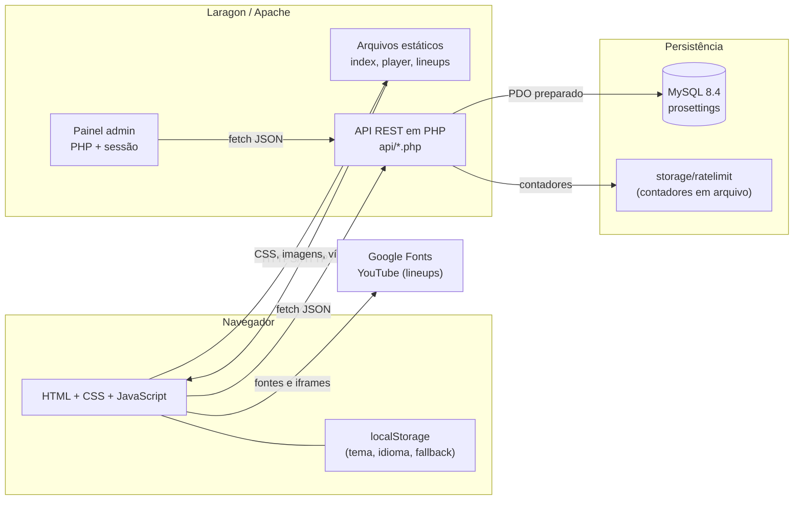
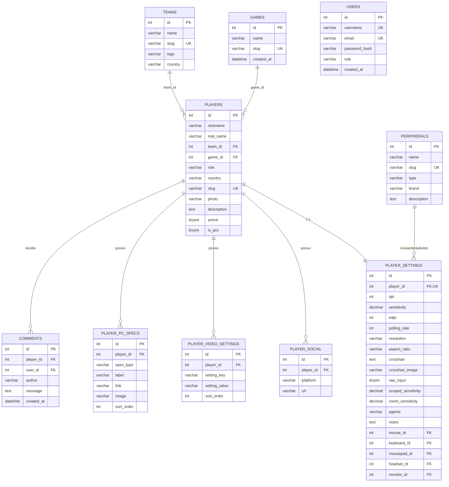
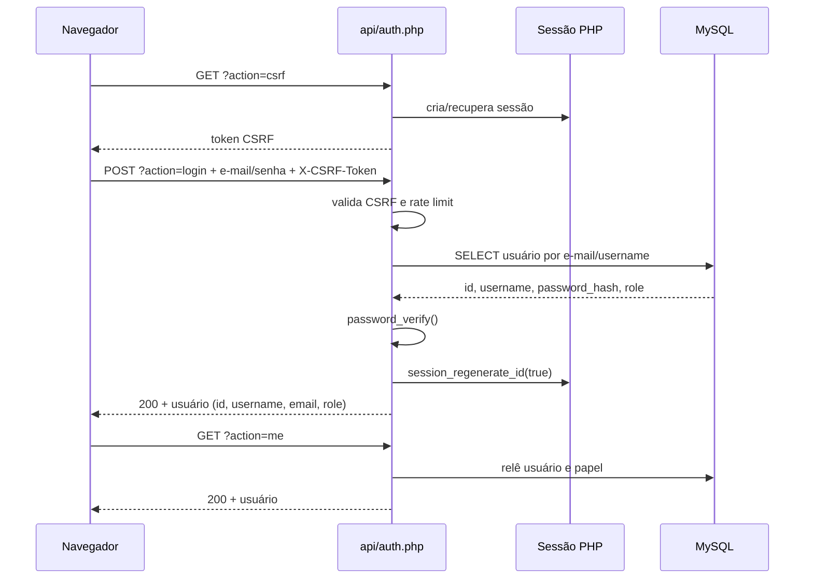
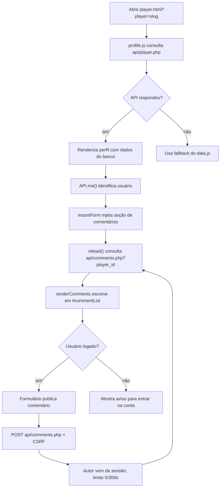
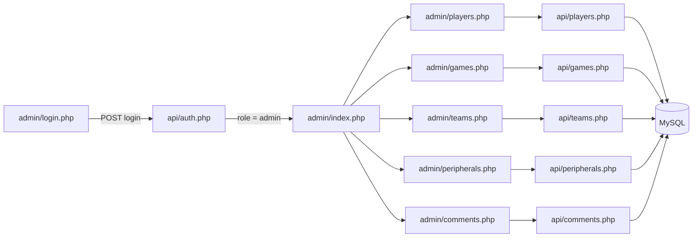
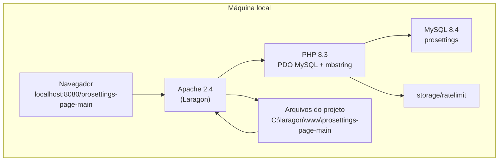

# Diagramas do AimBase

Este arquivo reúne os diagramas do projeto em Mermaid. Eles podem ser renderizados
no GitHub, no VS Code (extensão Markdown Preview Mermaid Support) ou em
<https://mermaid.live>. Para a monografia em PDF/DOCX, exporte cada diagrama como
PNG/SVG e insira na seção correspondente.

## Figura D1 — Arquitetura geral

O frontend é estático; o PHP atua apenas na API e no painel administrativo. A
sessão é compartilhada entre site, API e painel por cookie `HttpOnly`.

## Figura D2 — Modelo entidade-relacionamento (DER)

## Figura D3 — Fluxo de login, sessão e CSRF

Pontos importantes:

- o papel (`role`) é lido do banco a cada requisição, e não apenas da sessão;
- qualquer escrita exige o token CSRF, comparado com `hash_equals`;
- o login bem-sucedido limpa o contador de tentativas e regenera o ID da sessão.

## Figura D4 — Fluxo de comentários

## Figura D5 — Fluxo do painel administrativo

Todas as páginas do painel passam por `admin/includes/header.php`, que exige
sessão e `role = admin`. Um usuário comum recebe 403; um visitante é redirecionado
para o login.

## Figura D6 — Implantação local no Laragon

## Como exportar

1. **VS Code**: abra este arquivo no preview e use a extensão de Mermaid, ou
   exporte pelo comando da extensão.
2. **Mermaid Live**: cole cada bloco e exporte PNG em 2× para manter a nitidez.
3. **Pandoc/LaTeX**: use um filtro Mermaid (`mermaid-filter`) ou exporte as
   imagens antes de gerar o PDF.
4. Nomeie os arquivos como `figura-d1-arquitetura.png`, `figura-d2-der.png` etc.,
   e insira na monografia com legenda e fonte.
