[INSTITUIÇÃO DE ENSINO]
CURSO TÉCNICO EM DESENVOLVIMENTO DE SISTEMAS

GUSTAVO PACHECO
IGOR GOMES
GABRIEL FELIPI
VICTORIA DOMINGOS

**AimBase: plataforma web para consulta e compartilhamento de configurações de jogadores de e-sports**

Trabalho de Conclusão de Curso apresentado ao Curso Técnico em Desenvolvimento
de Sistemas da [INSTITUIÇÃO DE ENSINO], como requisito parcial para obtenção do
título de Técnico em Desenvolvimento de Sistemas.

Orientador: Prof. Anderson [sobrenome]

[CIDADE]
2026

---

[INSTITUIÇÃO DE ENSINO]
CURSO TÉCNICO EM DESENVOLVIMENTO DE SISTEMAS

GUSTAVO PACHECO
IGOR GOMES
GABRIEL FELIPI
VICTORIA DOMINGOS

**AimBase: plataforma web para consulta e compartilhamento de configurações de jogadores de e-sports**

Trabalho de Conclusão de Curso apresentado ao Curso Técnico em Desenvolvimento
de Sistemas da [INSTITUIÇÃO DE ENSINO], como requisito parcial para obtenção do
título de Técnico em Desenvolvimento de Sistemas.

Aprovado em: 02/12/2026.

Banca examinadora:

__________________________________________
Prof. Anderson [sobrenome] — Orientador

__________________________________________
Prof. [nome] — Avaliador

__________________________________________
Prof. [nome] — Avaliador

[CIDADE]
2026

---

# RESUMO

O cenário competitivo de e-sports depende de configurações precisas de mouse,
sensibilidade, retícula, vídeo e periféricos. Essas informações ficam dispersas em
vídeos, transmissões, planilhas e páginas estrangeiras, o que dificulta a consulta
por jogadores iniciantes e intermediários. Este trabalho descreve o AimBase, uma
plataforma web desenvolvida para centralizar perfis de jogadores profissionais,
seus ajustes e equipamentos, com interface em cinco idiomas, comentários da
comunidade e painel administrativo. A solução foi construída com HTML, CSS e
JavaScript no frontend, API REST em PHP e banco de dados MySQL, aplicando
controle de sessão, papéis de usuário, proteção CSRF, CORS restrito, limites de
requisição e consultas preparadas. O sistema foi validado por meio de análise
estática, testes HTTP e navegador headless, cobrindo autenticação, autorização,
CRUD, comentários, internacionalização, tema claro/escuro e responsividade. Os
resultados indicam que a proposta atende aos objetivos de centralização,
acessibilidade e administração do conteúdo, com limitações documentadas e
trabalhos futuros definidos.

**Palavras-chave:** e-sports. aplicação web. API REST. MySQL. segurança. AimBase.

---

# ABSTRACT

The competitive e-sports scenario relies on precise mouse, sensitivity, crosshair,
video and peripheral settings. This information is scattered across videos,
streams, spreadsheets and foreign websites, making it difficult for beginner and
intermediate players to consult. This work describes AimBase, a web platform
developed to centralize professional player profiles, their settings and gear,
with a five-language interface, community comments and an administrative panel.
The solution was built with HTML, CSS and JavaScript on the frontend, a REST API
in PHP and a MySQL database, applying session control, user roles, CSRF
protection, restricted CORS, request rate limits and prepared statements. The
system was validated through static analysis, HTTP tests and a headless browser,
covering authentication, authorization, CRUD, comments, internationalization,
light/dark theme and responsiveness. The results indicate that the proposal meets
the goals of centralization, accessibility and content administration, with
documented limitations and future work defined.

**Keywords:** e-sports. web application. REST API. MySQL. security. AimBase.

---

# LISTA DE FIGURAS

| Figura | Descrição |
| ------ | --------- |
| 1 | Arquitetura geral da solução |
| 2 | Modelo entidade-relacionamento |
| 3 | Página inicial do AimBase |
| 4 | Perfil de jogador com configurações |
| 5 | Seção de comentários do perfil |
| 6 | Página de lineups |
| 7 | Página de jogador não encontrado |
| 8 | Tela de login do painel administrativo |
| 9 | Painel administrativo |
| 10 | Gerenciamento de jogos no painel |
| 11 | Versão mobile da página inicial |
| 12 | Interface em inglês |

*As páginas exatas de cada figura devem ser atualizadas na versão final em PDF/DOCX.*

# LISTA DE TABELAS

| Tabela | Descrição |
| ------ | --------- |
| 1 | Comparativo qualitativo com trabalhos relacionados |
| 2 | Requisitos funcionais |
| 3 | Requisitos não funcionais |
| 4 | Tecnologias utilizadas |
| 5 | Entidades do banco de dados |
| 6 | Endpoints principais da API |
| 7 | Casos de teste de API e segurança |
| 8 | Validação de navegador e responsividade |

# LISTA DE ABREVIATURAS E SIGLAS

| Sigla | Significado |
| ----- | ----------- |
| API | Application Programming Interface |
| ABNT | Associação Brasileira de Normas Técnicas |
| CORS | Cross-Origin Resource Sharing |
| CRUD | Create, Read, Update, Delete |
| CSRF | Cross-Site Request Forgery |
| DER | Diagrama Entidade-Relacionamento |
| DPI | Dots Per Inch |
| eDPI | Effective Dots Per Inch |
| FK | Foreign Key |
| HTTP | Hypertext Transfer Protocol |
| i18n | Internacionalização |
| JSON | JavaScript Object Notation |
| LGPD | Lei Geral de Proteção de Dados |
| MVC | Model-View-Controller |
| OWASP | Open Worldwide Application Security Project |
| PDO | PHP Data Objects |
| PK | Primary Key |
| REST | Representational State Transfer |
| SQL | Structured Query Language |
| UI | User Interface |
| UX | User Experience |
| WCAG | Web Content Accessibility Guidelines |
| XSS | Cross-Site Scripting |

# SUMÁRIO

1 INTRODUÇÃO
1.1 Contextualização
1.2 Problema
1.3 Objetivos
1.4 Justificativa
1.5 Metodologia
2 FUNDAMENTAÇÃO TEÓRICA
2.1 E-sports e configurações competitivas
2.2 Aplicações web e arquitetura cliente-servidor
2.3 APIs REST e JSON
2.4 Banco de dados relacional
2.5 Segurança em aplicações web
2.6 Internacionalização, responsividade e acessibilidade
2.7 Trabalhos relacionados
3 ANÁLISE E REQUISITOS
3.1 Visão geral da solução
3.2 Requisitos funcionais
3.3 Requisitos não funcionais
3.4 Regras de negócio
3.5 Público-alvo e cenários de uso
4 DESENVOLVIMENTO
4.1 Tecnologias utilizadas
4.2 Arquitetura da solução
4.3 Modelo de dados
4.4 Frontend
4.5 API e backend
4.6 Autenticação, autorização e segurança
4.7 Painel administrativo
4.8 Internacionalização, tema e responsividade
4.9 Tratamento de erros e fallback
4.10 Ambiente e implantação
5 TESTES E RESULTADOS
5.1 Estratégia de testes
5.2 Testes de API e segurança
5.3 Testes de navegador
5.4 Resultados visuais
5.5 Discussão
5.6 Limitações
6 CONCLUSÃO
6.1 Considerações finais
6.2 Trabalhos futuros
REFERÊNCIAS
APÊNDICE A — Endpoints da API
APÊNDICE B — Estrutura do banco de dados
APÊNDICE C — Roteiro de execução local

*Os números de página devem ser atualizados após a formatação final em Word/LibreOffice.*

---

# 1 INTRODUÇÃO

## 1.1 Contextualização

Os e-sports deixaram de ser um nicho recreativo e passaram a mover equipes,
patrocinadores, transmissões e uma audiência global. Hamari e Sjöblom (2017)
argumentam que o consumo de e-sports combina entretenimento, competição e
aprendizado, o que aproxima o público das decisões técnicas dos jogadores
profissionais. Entre essas decisões estão a sensibilidade do mouse, o DPI, a
retícula, a resolução, a taxa de atualização e os periféricos utilizados.

Essas configurações são um conhecimento competitivo. Um jogador que deseja
melhorar sua mira ou reproduzir o setup de um atleta precisa comparar valores,
entender a relação entre DPI e sensibilidade e verificar quais equipamentos
realmente fazem parte da rotina do profissional. Na prática, essa informação
costuma estar fragmentada em vídeos, transmissões ao vivo, capturas de tela,
planilhas e páginas em inglês.

O AimBase nasce desse contexto: uma aplicação web que reúne perfis de jogadores,
seus ajustes, periféricos e lineups, com administração de conteúdo e participação
da comunidade. O projeto foi desenvolvido como Trabalho de Conclusão de Curso do
Curso Técnico em Desenvolvimento de Sistemas, colocando em prática conceitos de
modelagem de dados, desenvolvimento web, APIs, segurança e interface.

## 1.2 Problema

A pergunta que orienta o trabalho é: **como centralizar, organizar e disponibilizar
configurações de jogadores de e-sports em uma aplicação web confiável, de fácil
consulta e com possibilidade de administração e participação da comunidade?**

O problema se desdobra em dificuldades específicas:

- informações espalhadas em fontes não estruturadas, como vídeos e transmissões;
- barreira linguística, já que boa parte do conteúdo técnico está em inglês;
- dados desatualizados ou sem indicação de origem;
- ausência de um canal simples para a comunidade comentar e complementar;
- dificuldade de manter o conteúdo atualizado sem uma área administrativa;
- experiências ruins em dispositivos móveis em alguns sites do segmento.

## 1.3 Objetivos

O objetivo geral é desenvolver uma plataforma web para consulta e compartilhamento
de configurações de jogadores profissionais de e-sports, com interface responsiva,
cinco idiomas, comentários da comunidade e painel administrativo.

Os objetivos específicos são:

- modelar um banco de dados relacional para jogadores, jogos, times, periféricos,
  configurações e comentários;
- implementar uma API REST em PHP para leitura pública e escrita autenticada;
- construir páginas de diretório, perfil e lineups com HTML, CSS e JavaScript;
- aplicar autenticação, autorização por papel, proteção CSRF, CORS restrito e
  limites de requisição;
- disponibilizar um painel administrativo com CRUD de jogadores, jogos, times,
  periféricos e moderação de comentários;
- oferecer internacionalização em português, inglês, espanhol, francês e alemão;
- validar o sistema com análise estática, testes HTTP e testes de navegador.

## 1.4 Justificativa

A justificativa acadêmica está na integração de conteúdos estudados ao longo do
curso: lógica de programação, banco de dados, desenvolvimento web, segurança e
engenharia de software. O projeto não se limita a uma página estática; ele exige
modelagem, API, autenticação, controle de acesso, tratamento de erros e
preocupação com usabilidade.

A justificativa social está na democratização do acesso à informação técnica.
Jogadores iniciantes podem comparar configurações e entender por que um
profissional usa determinada sensibilidade ou periférico. A interface em
português e em outros idiomas reduz a barreira linguística, e os comentários
permitem que a comunidade acrescente contexto.

A justificativa prática está na manutenção do conteúdo. Sem uma área
administrativa, o site envelhece rapidamente. O painel com CRUD e a API permitem
que novos jogadores, jogos e equipamentos sejam cadastrados sem alterar o código
das páginas.

## 1.5 Metodologia

Do ponto de vista da natureza, a pesquisa é aplicada, pois gera uma solução
tecnológica para um problema concreto. Do ponto de vista dos objetivos, é
exploratória e descritiva: primeiro foram levantados os tipos de informação que
compõem um setup competitivo; depois foi construída e avaliada uma plataforma.
Do ponto de vista do procedimento, adota-se o desenvolvimento iterativo, com
levantamento de requisitos, modelagem, implementação, testes e ajustes.

Segundo Gil (2017), a pesquisa aplicada concentra-se na aplicação prática de
conhecimentos para resolver problemas específicos. Sommerville (2016) destaca que
o desenvolvimento incremental permite entregar versões funcionais e refinar o
sistema com base em validação. Pressman e Maxim (2020) reforçam que a engenharia
de software deve equilibrar requisitos, qualidade e manutenção ao longo do ciclo. O projeto seguiu essa lógica: a base de dados e a
API vieram antes do painel, e a validação de segurança foi feita antes da
publicação da versão final.

As etapas foram:

1. levantamento dos requisitos e das entidades do domínio;
2. modelagem do banco e definição dos endpoints;
3. implementação do frontend e da API;
4. implementação do painel administrativo e das regras de acesso;
5. aplicação de internacionalização, tema e responsividade;
6. análise estática, testes HTTP e testes de navegador;
7. correção dos problemas encontrados e documentação.

A validação não incluiu pesquisa de usabilidade com um grupo amplo de usuários;
trata-se de uma validação técnica e funcional, complementada por inspeção visual
das telas. Essa limitação é retomada na seção 5.6.

---

# 2 FUNDAMENTAÇÃO TEÓRICA

## 2.1 E-sports e configurações competitivas

E-sports podem ser entendidos como competições organizadas de jogos eletrônicos,
com regras, equipes, treinamento e audiência. Hamari e Sjöblom (2017) mostram que
o público não consome apenas a partida: consome também a performance, a
personalidade e as escolhas dos jogadores. Nesse ecossistema, o setup é parte da
identidade competitiva.

As configurações mais consultadas são:

- **mouse**: DPI, sensibilidade no jogo, eDPI (DPI × sensibilidade), polling rate
  e aceleração;
- **retícula**: código de compartilhamento, cor, espessura e formato;
- **vídeo**: resolução, proporção, qualidade e taxa de atualização;
- **periféricos**: mouse, teclado, mousepad, headset e monitor;
- **agente/personagem** e função exercida no time.

O AimBase organiza esses dados em um perfil único, permitindo comparação e cópia
do código de retícula e dos valores principais. A plataforma não pretende ser
uma ferramenta de treino, mas uma fonte de referência estruturada.

## 2.2 Aplicações web e arquitetura cliente-servidor

A arquitetura cliente-servidor separa a interface executada no navegador do
processamento realizado no servidor. No AimBase, o navegador carrega HTML, CSS e
JavaScript estáticos (MDN WEB DOCS, 2026); o servidor Apache entrega esses
arquivos e executa os scripts PHP da API e do painel.

Essa separação traz vantagens: o frontend pode ser servido diretamente pelo
Apache, sem etapa de build; a API pode ser testada de forma independente; e o
painel administrativo reutiliza a mesma fonte de dados. A desvantagem é a
necessidade de tratar autenticação, CORS e estados de carregamento no cliente.

## 2.3 APIs REST e JSON

REST (Representational State Transfer) foi descrito por Fielding (2000) como um
estilo arquitetural baseado em recursos identificados por URLs, comunicação sem
estado e uso de métodos padronizados do HTTP. O AimBase segue essa ideia:

- `GET` para leitura;
- `POST` para criação;
- `PUT` para atualização;
- `DELETE` para remoção.

As respostas usam JSON no formato `{ "success": true, "message": "", "data": ... }`,
o que facilita o consumo pelo JavaScript e padroniza o tratamento de erros. Os
códigos HTTP expressam o resultado: 200 para sucesso, 201 para criação, 400 para
requisição inválida, 401 para não autenticado, 403 para sem permissão, 404 para
não encontrado, 409 para conflito, 422 para validação e 429 para excesso de
requisições.

## 2.4 Banco de dados relacional

O banco de dados relacional organiza informações em tabelas com chaves primárias
e estrangeiras, garantindo integridade referencial. Date (2019) destaca que a
normalização reduz redundâncias e anomalias de atualização. No AimBase, jogadores
referenciam jogos e times; configurações referenciam jogadores e periféricos;
comentários referenciam jogadores e usuários.

O MySQL foi escolhido por ser gratuito, amplamente documentado (ORACLE
CORPORATION, 2026) e compatível com o Laragon. O acesso é feito via PDO com
consultas preparadas, o que separa o SQL dos valores enviados pelo cliente e
reduz o risco de injeção.

## 2.5 Segurança em aplicações web

O OWASP Top 10 (OWASP FOUNDATION, 2021) lista as categorias de risco mais
relevantes em aplicações web, entre elas controle de acesso quebrado, injeção,
falhas de autenticação e XSS. O projeto trata esses pontos de forma explícita:

- **controle de acesso**: papéis `user` e `admin`, com verificação no servidor;
- **injeção**: PDO com prepared statements;
- **XSS**: escape de saída com `htmlspecialchars` no PHP e `esc()` no JavaScript;
- **CSRF**: token por sessão exigido em toda escrita;
- **CORS**: allowlist de origens, em vez de liberar qualquer domínio;
- **força bruta**: rate limit em login, registro e comentários;
- **sessão**: cookie `HttpOnly`, `SameSite=Lax` e `Secure` quando HTTPS.

A segurança não pode depender apenas do frontend. Por isso, as regras são
aplicadas na API: mesmo que alguém chame o endpoint diretamente, sem sessão,
papel ou token, a operação é recusada.

## 2.6 Internacionalização, responsividade e acessibilidade

Internacionalização (i18n) é a preparação da interface para diferentes idiomas e
formatos. O AimBase mantém cinco dicionários JSON com as mesmas 194 chaves e usa
atributos `data-i18n` para textos fixos. Textos montados por JavaScript são
traduzidos por `I18N.t()` e redesenhados no evento `i18n:changed`. Datas são
formatadas com `Intl.DateTimeFormat`; números técnicos, como a sensibilidade,
não são localizados, pois `0.45` é o valor exibido pelo jogo.

A responsividade foi tratada com layout fluido e media queries. A validação em
390×844 não encontrou overflow horizontal nas páginas principais. A preocupação
com acessibilidade segue as WCAG 2.2 (W3C, 2023): rótulos acessíveis, textos
alternativos, região de status para o toast, foco e contraste. Princípios
clássicos de usabilidade (NIELSEN, 1994) orientaram a hierarquia visual, o
feedback imediato e a prevenção de erros.

## 2.7 Trabalhos relacionados

| Solução | Pontos fortes | Limitações em relação ao AimBase |
| ------- | ------------- | -------------------------------- |
| ProSettings.net | Grande base de jogadores e filtros | Interface predominantemente em inglês; foco comercial |
| Liquipedia | Conteúdo colaborativo e abrangente | Voltada a campeonatos e históricos; configurações não são o centro |
| Vídeos e transmissões | Contexto e demonstração visual | Informação não estruturada, difícil de comparar e pesquisar |
| Planilhas comunitárias | Flexibilidade | Sem validação, controle de acesso ou interface amigável |
| Sites de periféricos | Detalhes de produtos | Não comparam jogadores nem configurações |

*Tabela 1 — Comparativo qualitativo. Fonte: elaborado pelos autores (2026).*

O AimBase não substitui essas fontes; ele ocupa um espaço específico: uma base
acadêmica, em português, com administração, comentários e cinco idiomas. A
proposta é ser simples de consultar e fácil de manter.

---

# 3 ANÁLISE E REQUISITOS

## 3.1 Visão geral da solução

O sistema é composto por três páginas públicas e um painel:

- **index.html**: diretório de jogadores, busca e filtros por jogo, time, função,
  país e faixa de sensibilidade;
- **player.html**: perfil individual com carta do jogador, configurações de mouse,
  retícula, setup, vídeos, especificações de PC, redes sociais e comentários;
- **lineups.html**: mapas e vídeos de lineups;
- **admin/**: login e CRUD de jogadores, jogos, times, periféricos e comentários.

## 3.2 Requisitos funcionais

| Código | Requisito | Prioridade |
| ------ | --------- | ---------- |
| RF01 | Listar jogadores com busca e filtros | Alta |
| RF02 | Exibir perfil individual por slug ou id | Alta |
| RF03 | Copiar configurações e código de retícula | Média |
| RF04 | Exibir página 404 para jogador inexistente | Média |
| RF05 | Permitir cadastro, login, logout e consulta da sessão | Alta |
| RF06 | Exibir e publicar comentários autenticados | Alta |
| RF07 | Permitir que o autor ou um admin exclua comentários | Média |
| RF08 | Oferecer CRUD administrativo de jogadores, jogos, times e periféricos | Alta |
| RF09 | Oferecer moderação de comentários no painel | Média |
| RF10 | Exibir lineups por mapa com vídeos incorporados | Média |
| RF11 | Traduzir a interface para cinco idiomas | Média |
| RF12 | Alternar tema claro/escuro | Baixa |
| RF13 | Manter fallback estático quando a API não responde | Média |

*Tabela 2 — Requisitos funcionais. Fonte: elaborado pelos autores (2026).*

## 3.3 Requisitos não funcionais

| Código | Requisito |
| ------ | --------- |
| RNF01 | Segurança: sessão, CSRF, CORS, rate limit e consultas preparadas |
| RNF02 | Desempenho: carregamento sob demanda de imagens, vídeos e iframes |
| RNF03 | Usabilidade: navegação simples, feedback por toast e estados de carregamento |
| RNF04 | Acessibilidade: rótulos, contraste, foco e textos alternativos |
| RNF05 | Responsividade: uso em desktop e celular sem overflow horizontal |
| RNF06 | Manutenibilidade: separação entre dados, API, frontend e painel |
| RNF07 | Portabilidade: execução em Laragon com PHP e MySQL |
| RNF08 | Privacidade: coleta mínima de dados e senha armazenada com hash |

*Tabela 3 — Requisitos não funcionais. Fonte: elaborado pelos autores (2026).*

## 3.4 Regras de negócio

- apenas administradores podem criar, editar ou excluir jogadores, jogos, times e
  periféricos;
- qualquer usuário autenticado pode comentar; o autor exibido é sempre o
  `username` da sessão;
- o comentário tem limite de 500 caracteres e de 5 envios por 300 segundos por
  sessão;
- o autor pode excluir o próprio comentário; um admin pode excluir qualquer um;
- slugs de jogadores, jogos, times e periféricos são únicos;
- ao excluir um jogo ou time, os jogadores relacionados ficam sem esse vínculo
  (`ON DELETE SET NULL`);
- ao excluir um jogador, configurações, redes sociais, vídeos, especificações e
  comentários são removidos em cascata;
- se a API estiver indisponível, o site usa os dados estáticos do `data.js` e o
  formulário de comentários volta ao modo local.

## 3.5 Público-alvo e cenários de uso

O público-alvo inclui jogadores iniciantes e intermediários, fãs de e-sports,
criadores de conteúdo e administradores do site. Dois cenários ilustram o uso:

1. **Consulta rápida**: um jogador abre a home, filtra por VALORANT e função
   "Duelista", escolhe um perfil e copia DPI, sensibilidade e código de retícula.
2. **Atualização de conteúdo**: um administrador entra no painel, cadastra um novo
   jogo, cria o jogador, associa time e periféricos e confere o perfil publicado.

---

# 4 DESENVOLVIMENTO

## 4.1 Tecnologias utilizadas

| Camada | Tecnologia | Uso no projeto |
| ------ | ---------- | -------------- |
| Frontend | HTML5 | Estrutura das páginas |
| Frontend | CSS3 | Tokens, layout, componentes e responsividade |
| Frontend | JavaScript (ES6+) | Consumo da API, filtros, tema, i18n e interações |
| Backend | PHP 8.3 | API REST, sessão e painel administrativo |
| Banco | MySQL 8.4 | Persistência dos dados |
| Servidor | Apache 2.4 (Laragon) | Entrega dos arquivos e execução do PHP |
| Ferramentas | Git, VS Code, Edge/Chromium headless | Versionamento, edição e validação |

*Tabela 4 — Tecnologias utilizadas. Fonte: elaborado pelos autores (2026).*

Não há etapa de build nem dependências npm: o Apache serve os arquivos
diretamente. Isso simplifica a implantação local e reduz a superfície de
dependências.

## 4.2 Arquitetura da solução

A arquitetura é organizada em três camadas: interface, API e persistência. A
interface consome a API via `fetch`; a API usa PDO para acessar o MySQL; o painel
administrativo usa os mesmos endpoints com sessão de administrador.

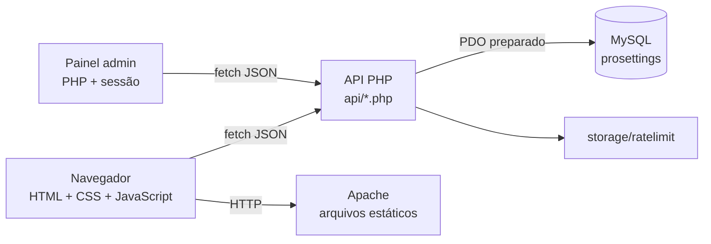

*Figura 1 — Arquitetura geral. Fonte: elaborado pelos autores (2026). O diagrama
detalhado está em `docs/diagramas.md` (Figura D1).*

A estrutura de pastas separa responsabilidades:

- `api/`: endpoints REST;
- `admin/`: páginas e includes do painel;
- `includes/`: conexão, autenticação, funções e rate limit;
- `config/`: configuração de banco, com arquivo local opcional;
- `database/`: schema, seed, migração e seed de desenvolvimento;
- `assets/`: CSS, JavaScript, imagens, i18n e vídeos;
- `docs/`: monografia, diagramas, slides e capturas de tela.

## 4.3 Modelo de dados

O banco `prosettings` possui tabelas para jogos, times, jogadores, configurações,
periféricos, dados complementares, usuários e comentários. A modelagem evita
repetir os mesmos dados em várias tabelas e usa chaves estrangeiras para manter a
integridade.

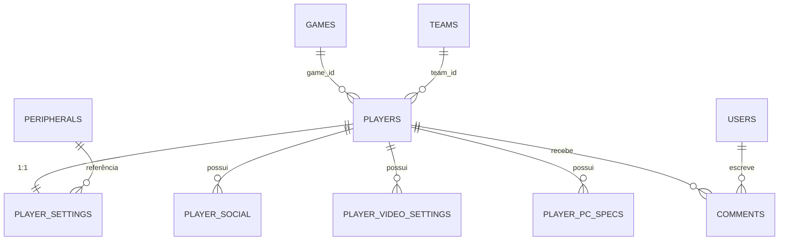

*Figura 2 — Modelo entidade-relacionamento. Fonte: elaborado pelos autores (2026).
O DER completo, com atributos, está em `docs/diagramas.md` (Figura D2).*

| Entidade | Função |
| -------- | ------ |
| `players` | Dados do jogador, nick, nome, time, jogo, função, país e slug |
| `player_settings` | DPI, sensibilidade, eDPI, retícula, resolução e vínculos com periféricos |
| `games` | Jogos disponíveis (VALORANT, CS2 etc.) |
| `teams` | Times e país |
| `peripherals` | Mouse, teclado, mousepad, headset e monitor |
| `player_social` | Redes sociais do jogador |
| `player_video_settings` | Configurações de vídeo em formato chave-valor |
| `player_pc_specs` | Componentes e especificações do PC |
| `users` | Contas de autenticação com `role` |
| `comments` | Comentários associados a jogador e usuário |

*Tabela 5 — Entidades do banco. Fonte: elaborado pelos autores (2026).*

A tabela `player_settings` tem relação 1:1 com `players` (`player_id` é único).
As tabelas complementares usam `ON DELETE CASCADE`: ao remover um jogador, seus
dados dependentes também são removidos. Já `games` e `teams` usam
`ON DELETE SET NULL`, preservando o jogador caso o jogo ou time seja excluído.

## 4.4 Frontend

O frontend foi escrito em JavaScript moderno (FLANAGAN, 2020), sem framework e
sem etapa de build, apoiado em módulos compartilhados (`shared.js`, `api.js` e
`i18n.js`) para evitar duplicação entre as páginas.

### 4.4.1 Página inicial

A home apresenta o diretório de jogadores em cards, com busca e filtros. Os dados
vêm de `api/players.php`; se a API não responder, o `data.js` fornece o fallback.
O layout usa CSS Grid e componentes reutilizáveis.

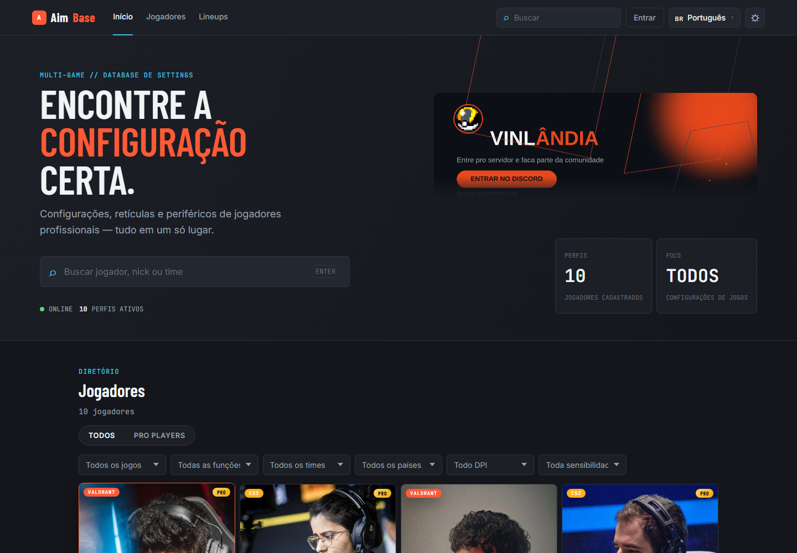

*Figura 3 — Página inicial. Fonte: elaborado pelos autores (2026).*

### 4.4.2 Perfil do jogador

O perfil é carregado por `player.html?player=slug` ou `?id=id`. A página exibe
carta do jogador, dados principais, configurações de mouse, retícula, setup,
vídeos, especificações de PC, redes sociais e comentários. O botão "Copiar
settings" monta um texto com DPI, sensibilidade, eDPI e retícula.

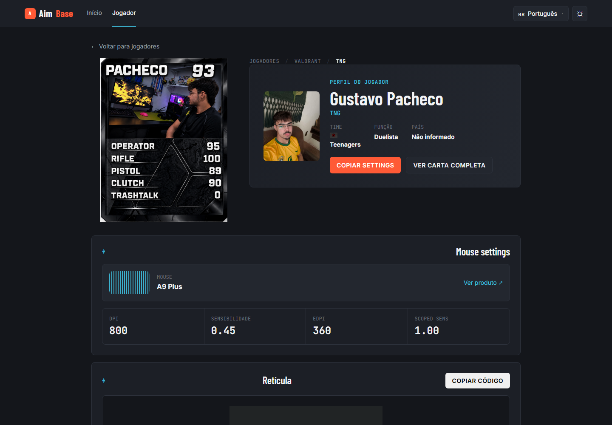

*Figura 4 — Perfil do jogador. Fonte: elaborado pelos autores (2026).*

### 4.4.3 Comentários

A seção de comentários é montada por JavaScript. O sistema consulta `API.me()`
para saber se há usuário logado. Com sessão, o formulário publica via API e o
autor vem do servidor; sem sessão, aparece o convite para entrar na conta. No
modo sem API, o comentário é salvo no `localStorage` e o campo de nome fica
disponível.

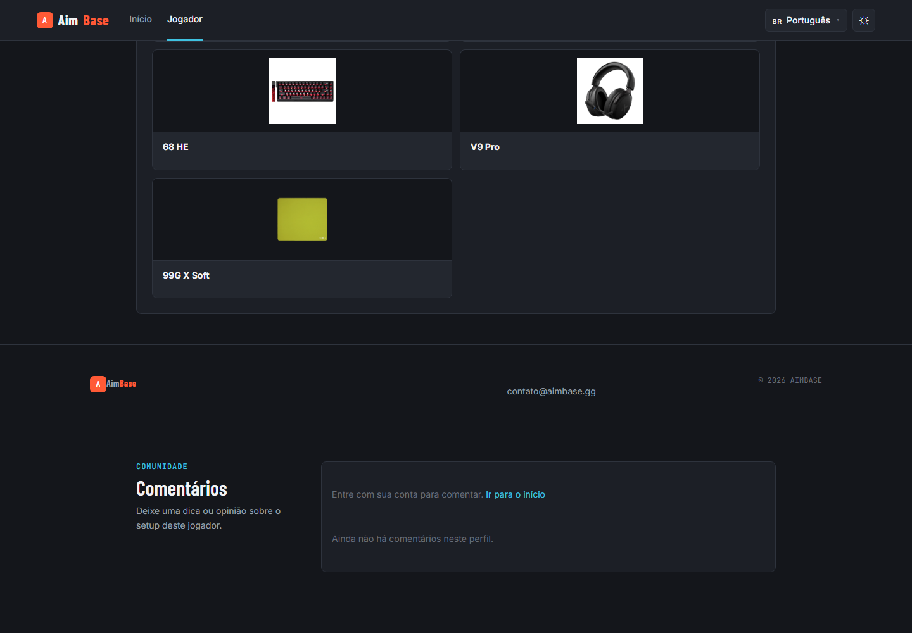

*Figura 5 — Comentários no perfil. Fonte: elaborado pelos autores (2026).*

### 4.4.4 Lineups

A página `lineups.html` organiza vídeos por mapa, com iframes carregados sob
demanda. A validação encontrou 12 blocos de mapa e 26 vídeos incorporados.

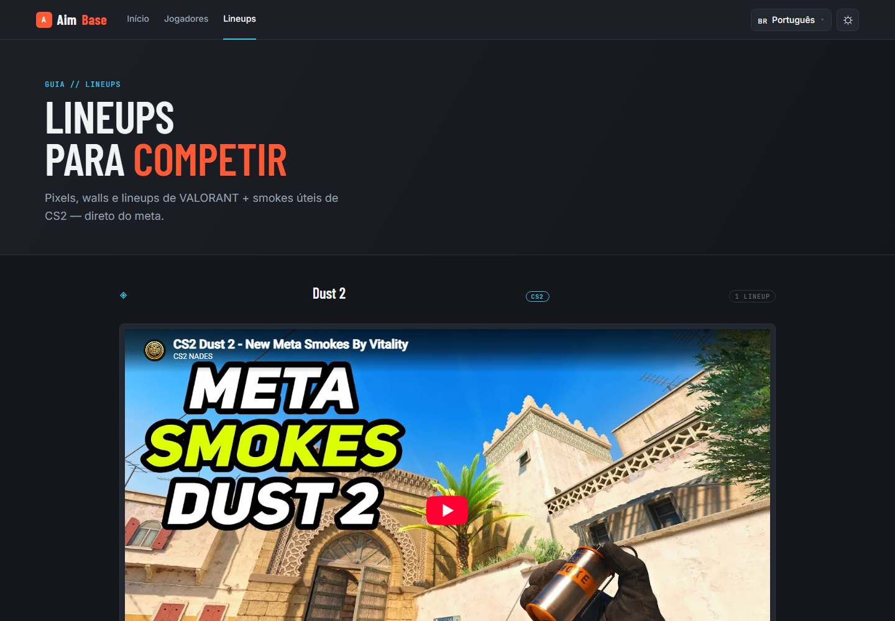

*Figura 6 — Lineups. Fonte: elaborado pelos autores (2026).*

### 4.4.5 Página 404

Quando o slug não existe, o perfil não é preenchido com dados vazios. A página
mostra uma seção de "jogador não encontrado" com o identificador solicitado e um
link de retorno. A API responde 404, e o cliente trata o erro.

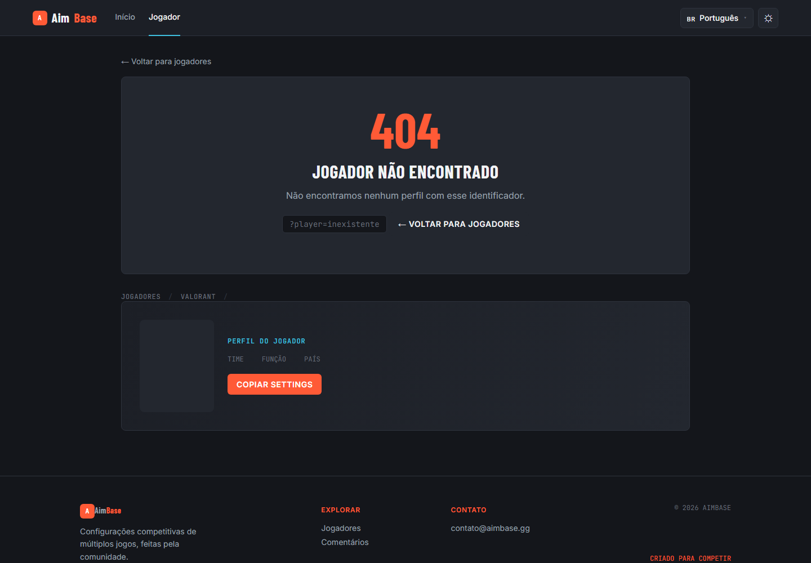

*Figura 7 — Página 404. Fonte: elaborado pelos autores (2026).*

## 4.5 API e backend

A API segue o padrão de recurso por arquivo (PHP DOCUMENTATION GROUP, 2026). Cada
endpoint valida o método, aplica CORS e, quando necessário, exige sessão, papel e
CSRF. As leituras públicas não exigem autenticação; as escritas exigem
`role = admin`.

| Método | Endpoint | Descrição | Acesso |
| ------ | -------- | --------- | ------ |
| GET | `/api/players.php` | Lista jogadores com filtros | Público |
| GET | `/api/player.php?slug=...` | Perfil completo por slug | Público |
| GET | `/api/games.php` | Lista jogos | Público |
| GET | `/api/teams.php` | Lista times | Público |
| GET | `/api/peripherals.php` | Lista periféricos | Público |
| GET | `/api/filters.php` | Metadados dos filtros | Público |
| GET | `/api/comments.php?player_id=1` | Comentários do jogador | Público |
| POST | `/api/auth.php?action=register` | Cria conta | Público |
| POST | `/api/auth.php?action=login` | Inicia sessão | Público |
| GET | `/api/auth.php?action=me` | Usuário da sessão | Sessão |
| GET | `/api/auth.php?action=csrf` | Token CSRF | Sessão |
| POST | `/api/comments.php` | Publica comentário | Usuário |
| DELETE | `/api/comments.php?id=1` | Exclui comentário | Autor/admin |
| POST/PUT/DELETE | `/api/players.php` | CRUD de jogador | Admin |
| POST/PUT/DELETE | `/api/games.php` | CRUD de jogo | Admin |
| POST/PUT/DELETE | `/api/teams.php` | CRUD de time | Admin |
| POST/PUT/DELETE | `/api/peripherals.php` | CRUD de periférico | Admin |

*Tabela 6 — Endpoints principais. Fonte: elaborado pelos autores (2026).*

O formato de resposta é consistente:

```json
{
  "success": true,
  "message": "Jogador criado.",
  "data": { "id": 15 }
}
```

Erros seguem o mesmo envelope, com `success: false` e mensagem em português. O
frontend usa essa mensagem para exibir o toast.

## 4.6 Autenticação, autorização e segurança

O fluxo de autenticação começa pela obtenção do token CSRF, seguida do login. A
API valida a senha com `password_verify()` e regenera o ID da sessão. O usuário é
lido do banco a cada requisição, e não apenas da sessão, para que uma mudança de
papel tenha efeito imediato.

O `includes/auth.php` centraliza:

- `bootSession()`: inicia a sessão com cookie seguro;
- `currentUser()`: consulta o usuário e o papel no banco;
- `requireUser()`: exige sessão;
- `requireRole('admin')`: exige papel de administrador;
- `requireAdminWrite()`: combina sessão, papel e CSRF.

As escritas usam `X-CSRF-Token` ou `csrf_token`, comparados com `hash_equals`.
O CORS usa uma allowlist: a própria origem, hosts locais do Laragon e as origens
definidas em `APP_ORIGIN`. As senhas usam `password_hash()` com o algoritmo
padrão do PHP.

O rate limit é implementado em arquivo, sem dependência externa: 5 registros por
hora por IP, 10 tentativas de login por 300 segundos por IP e 5 comentários por
300 segundos por sessão. O excesso retorna 429.

## 4.7 Painel administrativo

O painel exige login com `role = admin`. Um visitante é redirecionado para o
login; um usuário comum recebe 403. As páginas disponíveis são: painel, jogadores,
jogos, times, periféricos, comentários e edição de jogador.

O CRUD de jogos foi implementado sobre a API `api/games.php`, com listagem,
criação, edição e exclusão em modal. O mesmo padrão é usado em times e
periféricos.

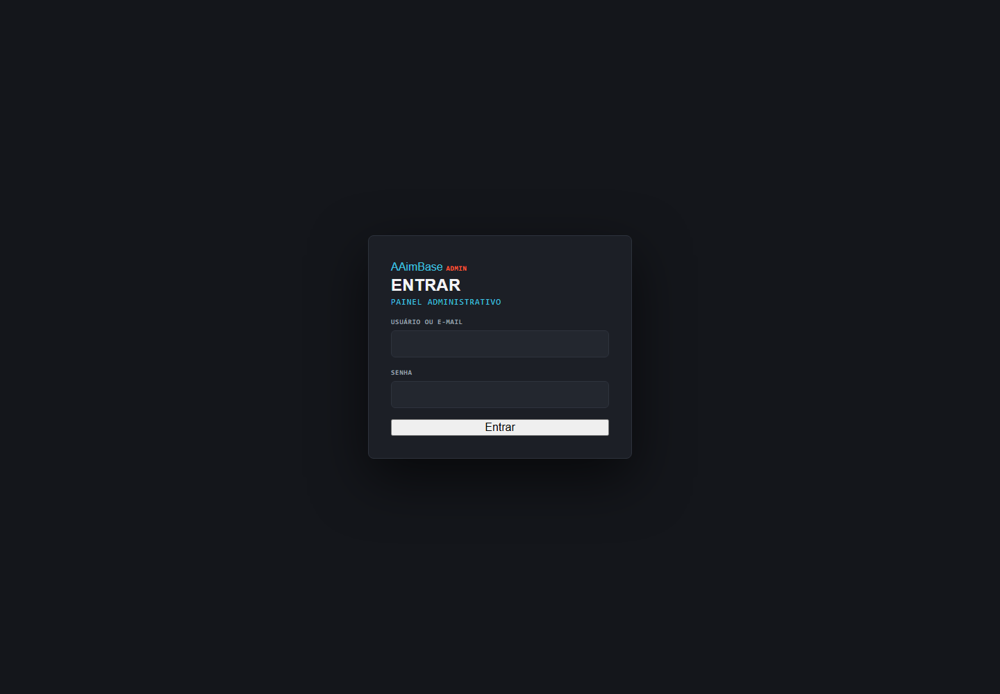

*Figura 8 — Login do painel. Fonte: elaborado pelos autores (2026).*

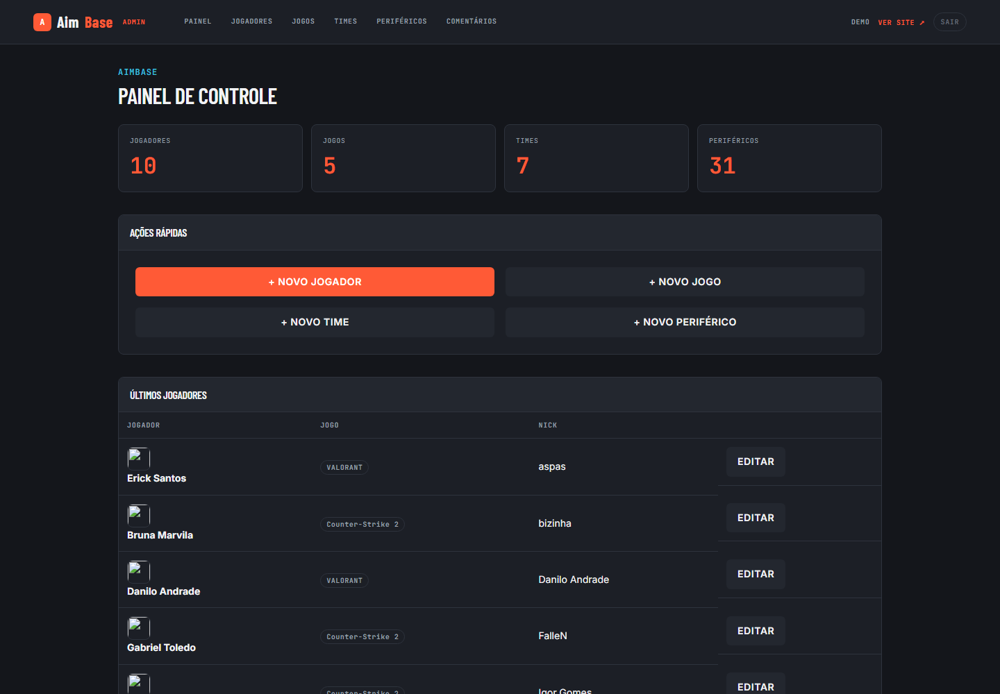

*Figura 9 — Painel. Fonte: elaborado pelos autores (2026).*

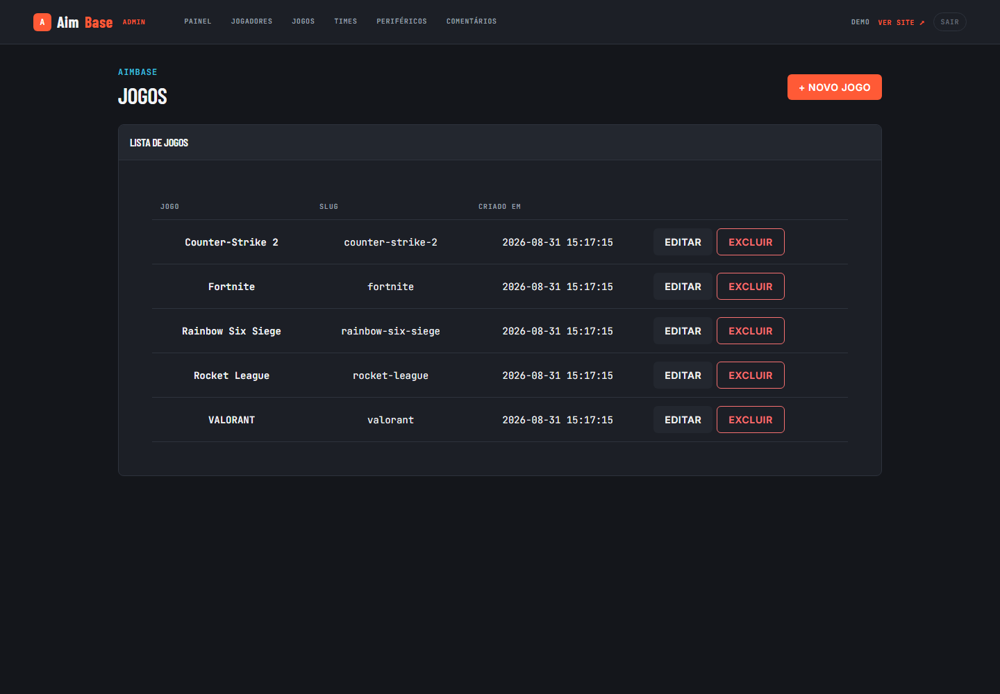

*Figura 10 — CRUD de jogos. Fonte: elaborado pelos autores (2026).*

## 4.8 Internacionalização, tema e responsividade

Os cinco dicionários (`assets/i18n/*.json`) têm 194 chaves cada. A escolha do
idioma é salva em `localStorage` e reaplicada nas visitas seguintes. Textos fixos
usam `data-i18n`; textos montados por JavaScript usam `I18N.t()` e são
redesenhados no evento `i18n:changed`.

O tema claro/escuro também é salvo em `localStorage` e aplicado no carregamento.
A responsividade foi validada em 390×844: home, perfil e lineups não apresentaram
overflow horizontal.

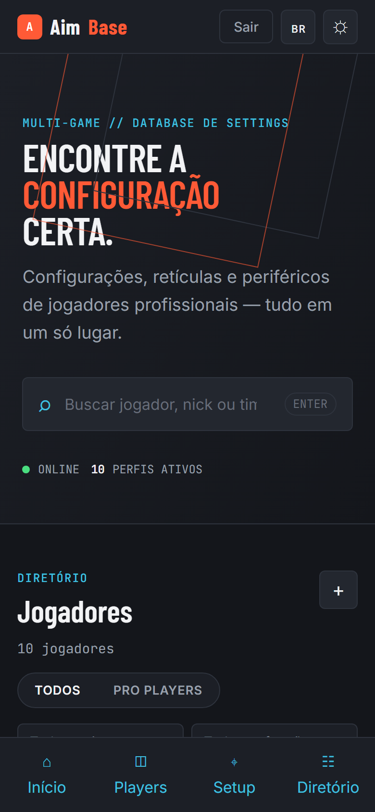

*Figura 11 — Versão mobile. Fonte: elaborado pelos autores (2026).*

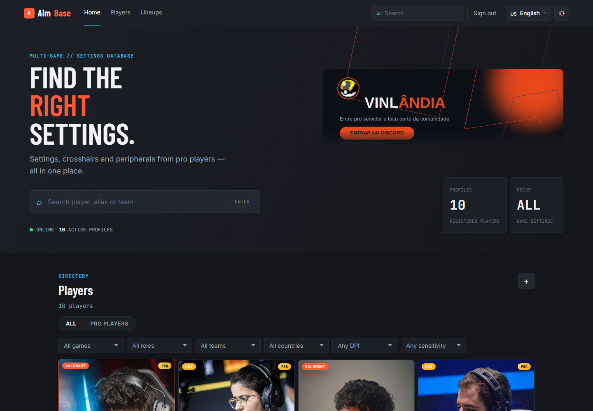

*Figura 12 — Interface em inglês. Fonte: elaborado pelos autores (2026).*

## 4.9 Tratamento de erros e fallback

O sistema trata três situações principais:

1. **API indisponível**: o frontend usa os dados do `data.js` e o modo local de
   comentários;
2. **jogador inexistente**: a API responde 404 e a página exibe a seção de erro;
3. **falha de validação ou permissão**: a API responde com mensagem e status
   adequados, e o frontend mostra um toast.

Essa estratégia evita telas quebradas e deixa claro para o usuário o que
aconteceu. O fallback é útil em demonstrações sem banco, mas não substitui a API
no uso normal.

## 4.10 Ambiente e implantação

O ambiente local usa Laragon com Apache, PHP 8.3 e MySQL 8.4. A instalação
consiste em:

1. copiar o projeto para `C:\laragon\www\prosettings-page-main`;
2. iniciar Apache e MySQL;
3. importar `database/schema.sql`;
4. importar `database/seed.sql`;
5. aplicar `database/migrations/001_users_role.sql` em bancos antigos;
6. executar `database/dev/seed-dev.sql` apenas no ambiente local para criar a
   conta `demo` (`demo@prosens.gg` / `demo1234`);
7. acessar `http://localhost:8080/prosettings-page-main/` (ou a porta configurada
   no Laragon).

A configuração de banco pode ser sobrescrita por `config/database.local.php`, que
fica fora do versionamento. As credenciais de demonstração não fazem parte do
seed de produção.

---

# 5 TESTES E RESULTADOS

## 5.1 Estratégia de testes

A validação combinou quatro abordagens:

- **análise estática**: `php -l` em todos os arquivos PHP e `node --check` nos
  JavaScript;
- **testes HTTP**: chamadas com `curl` para endpoints públicos e autenticados,
  incluindo cenários de erro;
- **testes de navegador**: Chromium/Edge headless via DevTools Protocol, com
  verificação de console, rede, layout e conteúdo renderizado;
- **inspeção visual**: capturas de tela das páginas principais.

Os testes foram executados no ambiente local com o banco de demonstração. A base
continha 10 jogadores e 5 jogos; comentários de teste foram criados e removidos
ao final.

## 5.2 Testes de API e segurança

| Caso | Procedimento | Resultado esperado | Resultado obtido |
| ---- | ------------ | ------------------ | ---------------- |
| Home e endpoints públicos | GET nas listas e no perfil | 200 com JSON | 200 |
| Jogador inexistente | GET `/api/player.php?slug=inexistente` | 404 | 404 |
| Escrita sem login | POST jogador sem sessão | 403 | 403 |
| Escrita sem CSRF | POST jogador com sessão, sem token | 403 | 403 |
| CSRF inválido | POST com token errado | 403 | 403 |
| CRUD admin | Criar, editar e excluir jogador | 201/200/200 | 201/200/200 |
| CRUD de jogo | Criar, editar e excluir jogo | 201/200/200 | 201/200/200 |
| Comentário sem login | POST sem sessão | 403 | 403 |
| Comentário autenticado | POST com sessão e CSRF | 201, autor da sessão | 201, autor `demo` |
| Exclusão de comentário | DELETE pelo autor | 200 | 200 |
| Painel sem sessão | GET `/admin/index.php` | 302 para login | 302 |
| Painel com usuário comum | GET `/admin/index.php` | 403 | 403 |
| Painel com admin | GET nas páginas do painel | 200 | 200 |

*Tabela 7 — Casos de teste de API e segurança. Fonte: elaborado pelos autores (2026).*

Um detalhe importante: durante os testes, uma ferramenta de linha de comando
reutilizou cabeçalhos e produziu um falso positivo de criação sem CSRF. A
verificação com `curl` confirmou o comportamento correto (403). O episódio
reforçou a necessidade de testar com mais de um cliente e de conferir o corpo da
resposta, não apenas o código.

## 5.3 Testes de navegador

| Verificação | Resultado |
| ----------- | --------- |
| Home com cards de jogadores | 10 cards renderizados, sem `undefined`/`NaN` |
| Perfil do Pacheco | Nome, time, DPI 800, sensibilidade 0,45 e eDPI 360 |
| Comentários deslogado | Seção presente com aviso de login |
| Página 404 | Seção de erro visível para slug inexistente |
| Lineups | 12 mapas e 26 vídeos incorporados |
| Idiomas | pt-BR, en, es, fr e de com troca efetiva e 194 chaves |
| Tema | Alternância claro/escuro e persistência em `localStorage` |
| Mobile 390×844 | Overflow horizontal 0 px em home, perfil e lineups |
| Admin | Painel, jogadores, jogos, times, periféricos, comentários e edição |
| Console | Sem exceções nas páginas testadas (exceto 404 esperado da API) |

*Tabela 8 — Validação de navegador e responsividade. Fonte: elaborado pelos autores (2026).*

## 5.4 Resultados visuais

As figuras desta seção mostram a interface final. A home organiza os jogadores em
cards e destaca a busca; o perfil concentra as informações técnicas; os lineups
priorizam vídeos; o painel usa tabelas e modais para facilitar a administração.

As capturas foram geradas em 1440×1000 (desktop) e 390×844 (mobile). A versão em
inglês demonstra a troca de idioma sem recarregar o conteúdo do perfil.

## 5.5 Discussão

Os objetivos foram atingidos: o sistema centraliza perfis, permite administração,
aceita comentários autenticados, funciona em cinco idiomas e foi validado em
desktop e mobile. A separação entre frontend estático e API mostrou-se adequada
para o escopo, pois simplifica a implantação e permite testar as regras de
negócio de forma independente.

Do ponto de vista de segurança, a combinação de sessão, papel, CSRF, CORS e rate
limit cobre os riscos mais comuns para uma aplicação desse porte. A leitura do
papel no banco a cada requisição é uma decisão conservadora que evita privilégios
residuais.

Do ponto de vista de usabilidade, o fallback e as mensagens de erro evitam telas
quebradas, mas a experiência ideal depende da API e do banco ativos. A
internacionalização foi tratada desde o início, o que evita retrabalho posterior.

## 5.6 Limitações

- a validação foi técnica e funcional, sem teste de usabilidade com uma amostra
  representativa de usuários;
- Discord, Google e "esqueceu a senha" são demonstrativos; o fluxo real é
  e-mail/senha;
- as tags Open Graph do perfil dinâmico são genéricas, pois scrapers sociais não
  executam JavaScript;
- os vídeos de clips em 4K somam cerca de 36 MB no repositório;
- não há pipeline de integração contínua nem suíte de testes automatizados no
  repositório; a validação foi feita por scripts externos e inspeção;
- comentários são somente texto, sem edição, respostas ou reações;
- não há verificação de e-mail nem recuperação de senha;
- a lista de comentários não tem paginação, o que pode ser limitante em perfis
  muito populares.

---

# 6 CONCLUSÃO

## 6.1 Considerações finais

O AimBase demonstrou que é possível construir uma plataforma de consulta de
configurações de e-sports com recursos profissionais usando uma stack acessível:
HTML, CSS, JavaScript, PHP e MySQL. O projeto integrou modelagem de dados, API
REST, autenticação, autorização, segurança, internacionalização, responsividade e
administração de conteúdo.

A experiência evidenciou que a maior parte do esforço não está na tela em si, mas
nas regras que garantem consistência e segurança: validar o papel no servidor,
exigir CSRF, limitar requisições, tratar erros e manter o seed coerente com o
frontend. O projeto também mostrou a importância de testar o fluxo completo, e não
apenas endpoints isolados.

Como entrega acadêmica, o sistema está funcional e documentado. A monografia, os
diagramas, os slides e as capturas de tela permitem reproduzir a instalação e
entender as decisões de projeto.

## 6.2 Trabalhos futuros

- realizar teste de usabilidade com jogadores e administradores;
- implementar recuperação de senha e verificação de e-mail;
- integrar login com Discord e Google de forma real;
- adicionar edição, respostas, reações e denúncia de comentários;
- criar paginação e busca nos comentários;
- ampliar a cobertura de jogos e periféricos;
- gerar imagens Open Graph dinâmicas por jogador;
- recomprimir ou externalizar os vídeos de 4K;
- adicionar pipeline de CI e testes automatizados;
- avaliar uma PWA com cache offline;
- internacionalizar também os dados de exemplo, quando fizer sentido;
- criar relatórios de uso e métricas para os administradores.

---

# REFERÊNCIAS

ASSOCIAÇÃO BRASILEIRA DE NORMAS TÉCNICAS. **NBR 6023**: informação e
documentação — referências — elaboração. Rio de Janeiro: ABNT, 2018.

ASSOCIAÇÃO BRASILEIRA DE NORMAS TÉCNICAS. **NBR 10520**: informação e
documentação — citações em documentos — apresentação. Rio de Janeiro: ABNT, 2023.

ASSOCIAÇÃO BRASILEIRA DE NORMAS TÉCNICAS. **NBR 14724**: informação e
documentação — trabalhos acadêmicos — apresentação. Rio de Janeiro: ABNT, 2011.

DATE, C. J. **Database Design and Relational Theory**: normalization theory and
relational design. 2. ed. Sebastopol: O'Reilly Media, 2019.

FIELDING, Roy Thomas. **Architectural Styles and the Design of Network-based
Software Architectures**. 2000. Tese (Doutorado em Ciência da Computação) —
University of California, Irvine, 2000. Disponível em:
<https://www.ics.uci.edu/~fielding/pubs/dissertation/top.htm>. Acesso em: 26 out.
2026.

FLANAGAN, David. **JavaScript**: the definitive guide. 7. ed. Sebastopol:
O'Reilly Media, 2020.

GIL, Antonio Carlos. **Como elaborar projetos de pesquisa**. 6. ed. São Paulo:
Atlas, 2017.

HAMARI, Juho; SJÖBLOM, Max. What is eSports and why do people watch it?
**Internet Research**, [S. l.], v. 27, n. 2, p. 211-232, 2017. DOI:
10.1108/IntR-04-2016-0087.

MDN WEB DOCS. **MDN Web Docs**: resources for developers, by developers.
Disponível em: <https://developer.mozilla.org/>. Acesso em: 26 out. 2026.

NIELSEN, Jakob. **Usability Engineering**. San Francisco: Morgan Kaufmann, 1994.

ORACLE CORPORATION. **MySQL 8.4 Reference Manual**. Disponível em:
<https://dev.mysql.com/doc/refman/8.4/en/>. Acesso em: 26 out. 2026.

OWASP FOUNDATION. **OWASP Top 10:2021**: the ten most critical web application
security risks. 2021. Disponível em: <https://owasp.org/Top10/>. Acesso em: 26
out. 2026.

PHP DOCUMENTATION GROUP. **PHP Manual**. Disponível em:
<https://www.php.net/manual/>. Acesso em: 26 out. 2026.

PRESSMAN, Roger S.; MAXIM, Bruce R. **Engenharia de software**: uma abordagem
profissional. 9. ed. Porto Alegre: AMGH, 2020.

SOMMERVILLE, Ian. **Software Engineering**. 10. ed. Boston: Pearson, 2016.

W3C. **Web Content Accessibility Guidelines (WCAG) 2.2**. 2023. Disponível em:
<https://www.w3.org/TR/WCAG22/>. Acesso em: 26 out. 2026.

---

# APÊNDICE A — Endpoints da API

| Método | Endpoint | Corpo/parâmetros | Retorno |
| ------ | -------- | ---------------- | ------- |
| GET | `/api/auth.php?action=csrf` | — | token CSRF |
| POST | `/api/auth.php?action=register` | `username`, `email`, `password` | usuário criado |
| POST | `/api/auth.php?action=login` | `email` ou `username`, `password` | usuário da sessão |
| GET | `/api/auth.php?action=me` | — | usuário da sessão |
| POST | `/api/auth.php?action=logout` | — | confirmação |
| GET | `/api/players.php` | filtros de jogo, time, função, país, sensibilidade | lista e total |
| GET | `/api/player.php?slug=...` | slug ou id | perfil completo |
| POST | `/api/players.php` | dados do jogador | id criado |
| PUT | `/api/players.php` | `id` + dados | id atualizado |
| DELETE | `/api/players.php?id=...` | id | confirmação |
| GET | `/api/games.php` | — | lista de jogos |
| POST/PUT/DELETE | `/api/games.php` | nome/slug/id | jogo criado/atualizado/excluído |
| GET | `/api/teams.php` | — | lista de times |
| POST/PUT/DELETE | `/api/teams.php` | nome/slug/país/logo/id | time criado/atualizado/excluído |
| GET | `/api/peripherals.php` | — | lista de periféricos |
| POST/PUT/DELETE | `/api/peripherals.php` | nome/tipo/marca/id | periférico criado/atualizado/excluído |
| GET | `/api/filters.php` | — | jogos, times, funções, países |
| GET | `/api/comments.php?player_id=...` | id do jogador | comentários |
| POST | `/api/comments.php` | `player_id`, `message` | comentário criado |
| DELETE | `/api/comments.php?id=...` | id | confirmação |

As escritas exigem sessão e token CSRF; as administrativas exigem
adicionalmente `role = admin`.

# APÊNDICE B — Estrutura do banco de dados

O script `database/schema.sql` cria o banco `prosettings` e as tabelas. O
`database/seed.sql` insere dados de exemplo. A migração
`database/migrations/001_users_role.sql` adiciona o papel de usuário em bancos
antigos. O `database/dev/seed-dev.sql` cria a conta de demonstração local.

Resumo das relações:

- `players.game_id` → `games.id` (`ON DELETE SET NULL`);
- `players.team_id` → `teams.id` (`ON DELETE SET NULL`);
- `player_settings.player_id` → `players.id` (`ON DELETE CASCADE`, único);
- `player_settings.mouse_id`, `keyboard_id`, `mousepad_id`, `headset_id`,
  `monitor_id` → `peripherals.id` (`ON DELETE SET NULL`);
- `player_social`, `player_video_settings`, `player_pc_specs` e `comments` →
  `players.id` (`ON DELETE CASCADE`);
- `comments.user_id` → `users.id`.

# APÊNDICE C — Roteiro de execução local

1. Inicie o Laragon e clique em **Start All**.
2. Confirme que o projeto está em `C:\laragon\www\prosettings-page-main`.
3. Abra o phpMyAdmin ou o terminal do MySQL.
4. Execute `database/schema.sql` e `database/seed.sql`.
5. Em banco antigo, execute `database/migrations/001_users_role.sql`.
6. No ambiente local, execute `database/dev/seed-dev.sql`.
7. Acesse `http://localhost:8080/prosettings-page-main/`.
8. Entre no painel com `demo@prosens.gg` / `demo1234` (somente desenvolvimento).
9. Para testar comentários, faça login no site, abra um perfil e publique.
10. Para encerrar, remova a conta demo com
    `DELETE FROM users WHERE username = 'demo';` se ela não for mais necessária.

> Em produção, não execute o seed de desenvolvimento e configure `APP_ORIGIN`,
> credenciais de banco e HTTPS. A conta `demo` nunca deve existir em produção.
